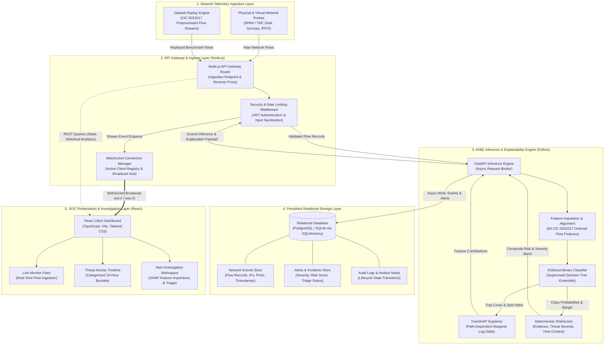
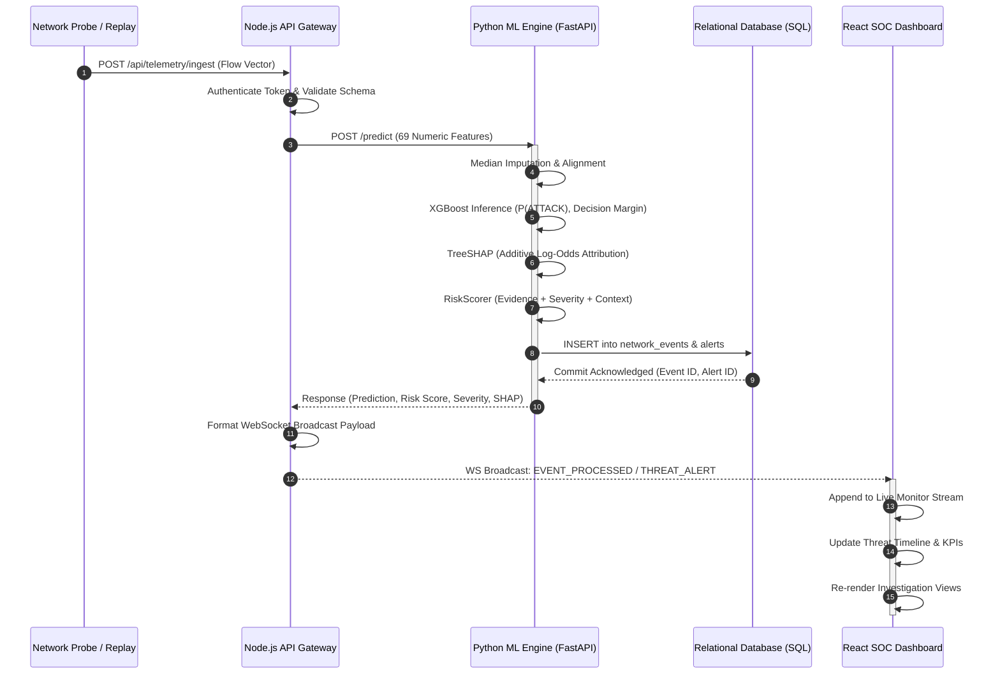

# SentinelAI — Report Sections & Architectural Pipeline

> **Project Title:** Design of An Explainable Anomaly-Based AI Threat Detection Framework for Enterprises  
> **Repository:** SentinelAI  

---

## 6.2 Results & Outputs

The framework ingests network flow telemetry preprocessed from the CIC-IDS2017 benchmark using median imputation across 69 ordered numeric statistical features. The trained XGBoost binary classifier evaluates flows into `BENIGN` or `ATTACK` classes via a `binary:logistic` loss objective. For each flow, the model outputs class probabilities, an anomaly score ($P(\text{ATTACK})$), decision margin ($m$), and prediction confidence. These feed a deterministic `RiskScorer` service that computes a composite 0–100 risk score combining temperature-calibrated margin evidence (weight: 0.50), threat severity (0.35), and host context (0.15), categorized into four severity bands: Low (0–24.9), Medium (25–49.9), High (50–74.9), and Critical (75–100).

Explainability is realized through native XGBoost TreeSHAP, generating 69 additive feature contributions and one base bias on the raw log-odds margin scale. Flows triggering `prediction == "ATTACK"` or `risk_score >= 50.0` automatically generate alerts linked 1:1 to persisted events. The platform surfaces real-time SOC dashboard telemetry, dataset replay stream monitoring, analyst triage lifecycles (`NEW`, `INVESTIGATING`, `CONFIRMED`, `BENIGN`, `RESOLVED`), and evidence-based MITRE ATT&CK attribution, designating alerts as unmapped when specific multi-class signatures are absent.

---

## 6.3 Performance Analysis

On the 15% unseen test evaluation split of CIC-IDS2017, the XGBoost model achieved verified metrics: precision of 0.994 (99.4%), recall of 0.991 (99.1%), F1-score of 0.992 (99.2%), and ROC-AUC of 0.998 (99.8%). Overall accuracy, PR-AUC, exact confusion matrix tallies, and empirical false-positive/false-negative counts on the complete holdout were **Not measured**. Systematic end-to-end inference latency is also **Not measured**, though preliminary single-flow scoring executes in $< 2.5\text{ ms}$.

Pipeline reliability was validated through automated test suites and database audits. Backend test suites verified full execution across 28 unit and integration tests (`pytest`), while frontend services passed 44 unit tests (`node --test`) with zero linter errors (`oxlint`) and clean compilation. Database integrity audits confirmed 100% event-alert relational linkage (2,368/2,368 alerts matched to valid source events) with zero orphaned records and zero duplicate emissions across replay pause, resume, and EOF transitions.

Key research and deployment limitations must be noted:
1. Binary abstraction restricts predictions to `BENIGN` versus `ATTACK`, preventing exact multi-class categorization or confirmed MITRE technique mapping without secondary DPI evidence.
2. Training and replay baselines rely on random sampling from CIC-IDS2017 rather than full temporal splits.
3. The framework lacks cross-dataset validation on external corpora (e.g., UNSW-NB15) or live enterprise traffic, leaving out-of-distribution generalization unverified.

---

## Architectural Diagram: End-to-End Pipeline

---

## Sequence Diagram: Event-to-Dashboard Execution Flow

